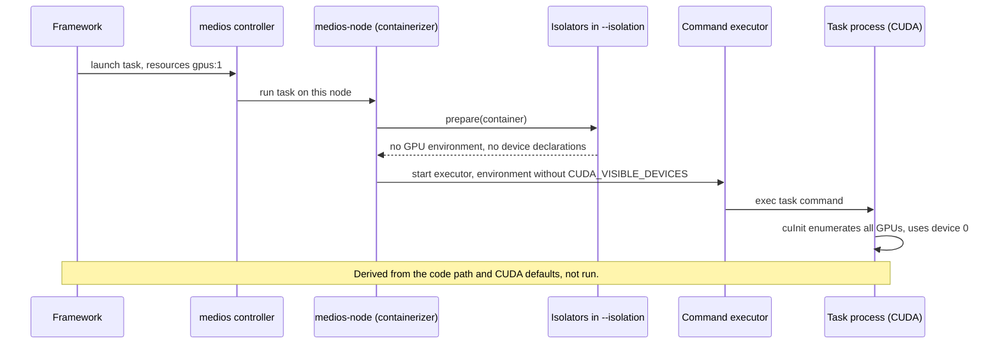

# Medios technical writing

Examples collected from review feedback on medios design documents.

## 1. Open on the concrete failure, not the concepts

Before:

> The controller accounts for GPUs as a scalar resource, `gpus`, and never names a device. Mapping a grant of `gpus:n` to physical devices is the node's job, and medios has two implementations of that mapping. Neither one runs on a node without a writable cgroup hierarchy, so on a RunPod pod no component binds a grant to a device.

After:

> Medios tracks how many GPUs a task receives, but the node must choose the physical devices. On the RunPod deployment described here, no node component makes that choice. One framework supplies its own CUDA_VISIBLE_DEVICES values; other frameworks cannot rely on those assignments.

Six concepts arrive before anything has gone wrong. Give one fact, then the failure; later concepts then answer questions the failure raised.

Note: the "after" text above still has the faults in entry 2 ("Medios tracks", "the node must choose").

## 2. Name the component; describe mechanism, not agency

Rejected:

> Medios tracks how many GPUs a task receives, but it leaves the choice of physical devices to the node.

Better:

> The medios controller records how many GPUs are allocated to each task. Which physical devices the task can open depends on the containerizer and isolators the node is configured with; the RunPod nodes ran with no isolator that binds an allocation to devices.

- "Medios" names the whole system. A system can't track something and leave a choice to one of its own parts; that is a category error. Name the component that acts: the controller.
- "Receives" claims delivery nobody verified. The controller knows what it allocated.
- "Leaves the choice to the node" turns one deployment into a property of the product. What happens to devices depends on node configuration, and there are several configurations.
- "Choice" gives the node agency. It runs code paths selected by configuration.
- Anthropomorphizing the system this way reads as model-written.

## 3. Say what the host is, and who actually selects the device

Rejected:

> On the RunPod pods medios currently runs on, no node component makes that choice.

Better:

> On a medios node running inside a RunPod pod, with no GPU isolator in `--isolation`, no medios component binds an allocation to a device. CUDA in each task opens device 0 unless the task's command sets `CUDA_VISIBLE_DEVICES`.

- "Pods medios runs on", lowercase and unintroduced, makes a pod sound like a different kind of thing from a medios node. Say what the pod is: the host the medios node runs inside.
- "No component makes that choice" is false: every task ends up on a device. Name the mechanism that selects it, CUDA's default enumeration, and the medios mechanism that is absent.

## 4. Keep host and medios node distinct in every sentence

Rejected:

> We observed this on 2026-11-26 on a pod with two A100s.

Better:

> We observed this on 2026-11-26 on a medios node running inside a RunPod pod with two A100 GPUs.

- "On a pod" treats the pod as the place the behaviour happens. The behaviour belongs to the medios node; the pod is its host and supplies the GPUs. Name both every time, or introduce the pair once and refer back to the medios node.

## 5. No false anchors: open a sentence on its subject, not a pointer back

Rejected:

> That node ran the medios containerizer with no GPU isolator in --isolation.

Better:

> The medios node in that pod used the medios containerizer, and its `--isolation` flag listed no GPU isolator.

- "That node" points back to a referent the reader has to find. Here none exists: the earlier sentences named a pod, not a node. A demonstrative opener fakes continuity, a classic model-writing tell.
- "A node ran the containerizer with no isolator in a flag" is garbled. The containerizer is part of medios-node, and `--isolation` is a node flag. State each fact with its own subject and verb.

## 6. Draw an execution path as a sequence diagram

Rejected:

> When a task asks for gpus:1, the containerizer prepares the container, and none of the listed isolators looks at the gpus resource. The executor then starts the command with the environment it was given, which contains no CUDA_VISIBLE_DEVICES. CUDA enumerates every device it can open and, by default, uses device 0. A task from another framework would therefore have run on device 0 alongside whichever tabular-bench task already held it. That outcome follows from the code path and CUDA's default behaviour; we did not run such a task.

Better:

- Six components hand off in order. Prose forces the reader to rebuild that order; a sequence diagram shows it, with each arrow naming its sender and receiver.
- Written as prose, the path drifted into errors: a task "asks for" nothing (a framework launches it with resources), and "whichever task already held it" implies a hold that nothing records.
- Keep the evidence qualifier as a note on the diagram.

## 7. Headings must stand alone

Rejected:

> Why the existing GPU module does not run there

Better:

> The containerizer refuses the GPU module's device declarations without cgroups/devices

- "There" is a false anchor, and in a heading it is worse than in a sentence. Readers skim headings out of context, so a heading that points back at prose they haven't read is the first thing that makes them dismiss the document.
- State the finding in the heading, with every referent named.

## 8. Resolve a design-changing unknown before writing; never document it as a loose end

Rejected:

> We have assumed the pods do not provide one, because they run unprivileged (observed 2026-11-10), but we have not inspected /sys/fs/cgroup on a pod. If a pod does expose a writable devices hierarchy, the module could run there unchanged, and the case for this proposal would rest only on the reasons in the next two sections.

Better: inspect `/sys/fs/cgroup` inside the pod first, then write the result as an observation with its date and method.

- A reader asks the obvious questions: why assume it, and why write it down instead of checking? Checking was the right answer.
- If the answer could change the design entirely, an unchecked assumption at the base of the proposal makes the document irresponsible, however honestly it is labelled.
- A technical document may carry an unknown only if it changes nothing about the design, or if it has an owned follow-up task and the document says why proceeding without the answer is acceptable.

## 9. Compare implementations in a matrix, not in colloquial prose

Rejected:

> The docker_shell containerizer, the other place medios assigns GPUs, needs a Docker daemon, and the pods have none (observed 2026-11-10). Its ledger also does not survive a node restart, because its recover() does nothing (#149).

Better:

| GPU path | Device assignment | `CUDA_VISIBLE_DEVICES` | Device enforcement | Assignment after medios-node restart | Host requirement |
| --- | --- | --- | --- | --- | --- |
| docker_shell containerizer | NVML indices, lowest free first, whole GPUs | Set via `docker run --gpus device=…` | Docker device rules | Lost: `recover()` is a no-op (#149) | Docker daemon |
| Medios containerizer + GPU module | NVML UUIDs from the units file | Not set | Device declarations through `cgroups/devices` | Restored from per-container checkpoint | Writable devices cgroup |
| Medios containerizer, no GPU isolator | None | Not set | None | Nothing recorded | None |

- "The other place medios assigns GPUs" is colloquial; a "place" is not a technical object. Name the component: the docker_shell containerizer.
- Several implementations measured on the same properties are a comparison. A matrix shows every property for every implementation, and a missing cell is visible; prose buries properties in clauses and drops some.

## 10. Name exactly what the proposal changes

Rejected:

> Assignment and device isolation are independent in the module's code. Only device isolation needs the cgroup. The proposal splits the module into two isolators in the same library, sharing one ledger.

Better:

> The change is to `GpuIsolator` in `src/modules/gpu/gpu_isolator.cpp`, the isolator that `libmedios_gpu.so` registers as `com_medioslab_medios_gpu`. Its `prepare()` assigns devices and records them in the ledger (lines 214-300); its `declare()` produces the device declarations that require `cgroups/devices` (lines 489-517). The proposal moves `declare()` and the device mounts into a second isolator class, registered as a second symbol from the same library, and moves the ledger out of `GpuIsolator` so both classes can read it.

- "The module" could mean the library, the registered symbol, the class or the directory. A reviewer approving a change needs the exact class, file, functions and symbols it touches.
- "Independent in the module's code" is a claim with no evidence attached; name the functions that show the independence.
- "The cgroup" refers to nothing introduced; say `cgroups/devices`.

## 11. Say what the operator configures, when, and with what effect

Rejected:

> An operator chooses between the two modes in --isolation alone:

Better:

> When configuring a medios node, the operator lists the GPU isolators in the node's `--isolation` flag. Listing `gpu/assign` alone makes the node assign devices and set `CUDA_VISIBLE_DEVICES` without restricting device access. Listing `gpu/assign,gpu/devices` also restricts each container to its assigned devices, and requires `cgroups/devices` in the same flag.

- "Chooses between the two modes" leaves the reader asking what the choice is. "Modes" was never defined, and no step of node configuration is named.
- Describe the configuration act (the flag, when it is set) and the behaviour each value produces.

## 12. Put per-configuration properties in the matrix, not in paragraphs

Rejected: two paragraphs (about 200 words) after the configuration block, explaining that `gpu/assign` alone doesn't enforce, that a task can override `CUDA_VISIBLE_DEVICES` or open `/dev/nvidia*`, that frameworks need an offer attribute to tell nodes apart, and how shares behave.

Better: add rows to the comparison matrix.

| `--isolation` GPU isolators | Task can use an unassigned GPU | Offer attribute (proposed) | Shares of one GPU |
| --- | --- | --- | --- |
| `gpu/assign` | Yes: by overriding `CUDA_VISIBLE_DEVICES` in its command (`executor.cpp:738-768`) or opening `/dev/nvidia*` | `gpu_isolation:assign` | Allowed by the units file; no memory or compute limit, so the default units file declares whole GPUs |
| `gpu/assign,gpu/devices` | No: the devices cgroup denies other device files | `gpu_isolation:assign,devices` | Allowed by the units file; device access only |

- A reader won't get through 200 words restating properties of two configurations; it's tl;dr.
- Each fact is one property of one configuration, so it belongs in a matrix cell. If a behaviour is a sequence of steps that matters to the decision, draw a sequence diagram (entry 6) instead.

## 13. End with a recommendation, not a list of unknowns

Rejected: a closing section, "What remains unverified", with five open claims after the alternatives.

Better: after the alternatives, a "Recommendation" section that says which alternative to take and the concrete next steps, in order.

- A design review needs a decision and a next action. A list of unknowns hands the author's work back to the reviewer.
- Verify before writing (entry 8). Something left unknown belongs inside the recommendation as a step with an owner, not in a list of loose ends.
